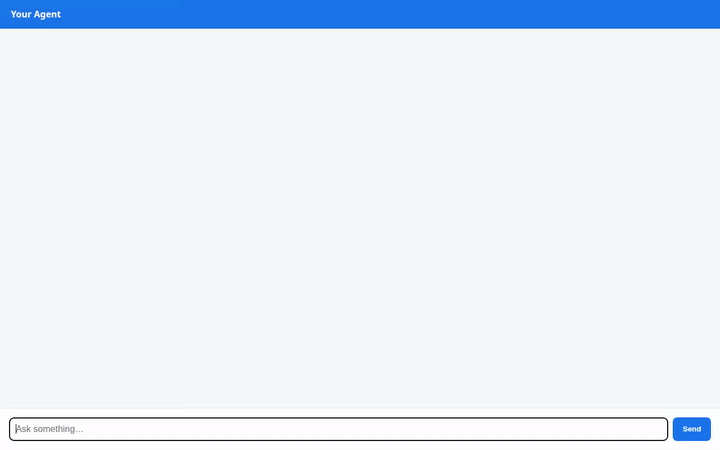

# ChambaBot 🛠️⚡

**El Asistente Eléctrico-Plomero y de Instalaciones del Hogar**

ChambaBot es un agente conversacional técnico construido con el **Google Agent Development Kit (ADK)** sobre la plataforma de **Google Cloud Vertex AI Agent Engine**. Está diseñado para asistir en tareas técnicas de plomería, instalaciones eléctricas y líneas de gas residencial. Realiza triage de seguridad inmediato ante emergencias domésticas, gestiona inventarios y refacciones en ferreterías/tlapalerías, genera diagramas e instrucciones en video, y ejecuta cálculos de dimensionamiento físico en entornos sandbox aislados.



---

## 🚀 Capacidades y Herramientas Implementadas

A diferencia de un asistente genérico, ChambaBot cuenta con herramientas Python asíncronas y síncronas conectadas a servicios nativos de Google Cloud:

### 1. Triage de Seguridad Inmediato (`triage_seguridad_urgente`)
- Evalúa alertas de emergencia en lenguaje coloquial (fugas de gas, chispas eléctricas, cortocircuitos, inundaciones).
- Clasifica el nivel de riesgo en semáforo (`CRITICO_EVACUAR`, `PELIGRO_ALTO`, `PRECAUCION`, `NORMAL`) y genera pasos inmediatos de mitigación antes de cualquier manipulación física.

### 2. Catálogo y Control de Stock en Firestore (`consultar_catalogo_firestore`, `registrar_material_en_firestore`, `actualizar_stock_compra`)
- **Google Cloud Firestore** almacena y persiste el catálogo de piezas y refacciones de tlapalería (`materiales_tlapaleria`).
- Mapea lenguaje coloquial y regionalismos (ej. *"sapito"*, *"pastilla"*, *"niple"*, *"teflón"*) a piezas y especificaciones técnicas.
- Permite consultar inventario, dar de alta nuevos insumos y actualizar stock en transacciones de compra o reposición.

### 3. Generación Visual de Diagramas Técnicos (`generar_diagrama_instalacion`)
- Genera ilustraciones y diagramas de conexión esquemáticos utilizando el modelo **`gemini-3.1-flash-lite-image`** en Vertex AI (región global).
- Guarda la imagen generada como artefacto de sesión (`tool_context.save_artifact`) para el panel de Artifacts y la publica en **Google Cloud Storage** retornando la URL pública para su visualización.

### 4. Generación de Video Demostrativo Multimodal (`generar_video_demostrativo`)
- Genera clips de video cortos instructivos usando el modelo Omni de Google **`gemini-omni-flash-preview`** en Vertex AI vía la API de Interacciones.
- Guarda el video MP4 en la sesión como artefacto y lo sube directamente al bucket de **Google Cloud Storage**, retornando la URL pública en HTTPS.

### 5. Meteorología y Condiciones de Trabajo (`consultar_clima_instalacion`)
- Consulta temperatura, humedad, viento y condiciones ambientales mediante la API pública de Open-Meteo para determinar la viabilidad de maniobras exteriores (trabajo en techos, impermeabilización, instalaciones eléctricas al aire libre).

### 6. Ejecución de Código en Sandbox Seguro (`AgentEngineSandboxCodeExecutor` & `calcular_dimensionamiento`)
- Ejecuta cálculos de física aplicada (caída de tensión por calibre AWG según Ley de Ohm, cálculo de presión hidráulica en columnas de agua) dentro de un entorno aislado de **Agent Engine Sandbox**.

### 7. Memoria a Largo Plazo y Perfil de Usuario (`PreloadMemoryTool` & `generate_memories_callback`)
- Integrado con **Vertex AI Memory Bank** (Agent Engine Memory Service).
- Extrae y almacena automáticamente preferencias e historial del inmueble (voltaje residencial, tipo de gas utilizado, herramientas con las que cuenta el usuario).

### 8. Interfaz Adaptativa A2UI (`a2ui_callback`)
- Formatea resúmenes técnicos, fichas de refacciones y checklists en tarjetas interactivas utilizando la especificación **A2UI (Agent to UI)** versión 0.8 con el Basic Catalog.

---

## ☁️ Servicios de Google Cloud Conectados

El código del repositorio tiene cableados los siguientes componentes:

| Servicio Google Cloud | Componente / Propósito |
| :--- | :--- |
| **Vertex AI Agent Engine** | Orquestación del agente (`remote_agent_runtime_id`), runtime y motor de ejecución. |
| **Vertex AI Memory Bank** | Persistencia de memoria conversacional y extracción continua de entidades del hogar. |
| **Agent Engine Code Sandbox** | Entorno seguro de ejecución Python para dimensionamiento eléctrico e hidráulico. |
| **Google Cloud Firestore** | Base de datos NoSQL para la colección `materiales_tlapaleria` y persistencia de inventario. |
| **Google Cloud Storage** | Bucket público para almacenamiento y distribución de diagramas e instructivos en video. |
| **Vertex AI Multimodal / Omni** | Modelos `gemini-3.1-flash-lite-image` y `gemini-omni-flash-preview` en región global. |
| **Cloud Run** | Servicio contenedorizado para hospedar el proxy y la interfaz web del usuario. |

> [!NOTE]
> **Funcionalidades planificadas no implementadas:**
> El streaming continuo de video con visión espacial AR vía WebSockets y el modelo on-device para lentes inteligentes descritos en el plan conceptual (`project_brief.md`) se encuentran documentados como extensiones a futuro y no están implementados en esta versión del backend.

---

## 💻 Instrucciones de Instalación y Ejecución Local

### Prerrequisitos
- Python 3.11+
- Administrador de entornos `uv`
- Google Cloud SDK (`gcloud`) autenticado con permisos en el proyecto de GCP

### 1. Clonar el repositorio y preparar entorno
```bash
git clone <URL_DEL_REPOSITORIO>
cd chambabot
uv sync
```

### 2. Configurar autenticación en Google Cloud
```bash
gcloud auth application-default login
gcloud config set project <TU_GCP_PROJECT_ID>
```

### 3. Iniciar el agente en el Playground local de ADK
Para ejecutar el agente con recarga en caliente y el servicio de memoria activo:
```bash
uv run adk web . --port 8080 --reload_agents --memory_service_uri=agentengine://<AGENT_ENGINE_ID>
```

### 4. Ejecutar el Frontend Web de Chat
Para correr el cliente web localmente desde el directorio `frontend/`:
```bash
cd frontend
python3 -m venv .venv
source .venv/bin/activate
pip install -r requirements.txt

export AGENT_ENGINE_RESOURCE_NAME="projects/<PROJECT_NUMBER>/locations/<REGION>/reasoningEngines/<ENGINE_ID>"
export AGENT_DIRECTORY="app"
export PORT=8080

python main.py
```

### 5. Despliegue a producción con Agents CLI
```bash
agents-cli deploy \
  --project <TU_GCP_PROJECT_ID> \
  --region us-central1 \
  --service-name simple-agent
```
